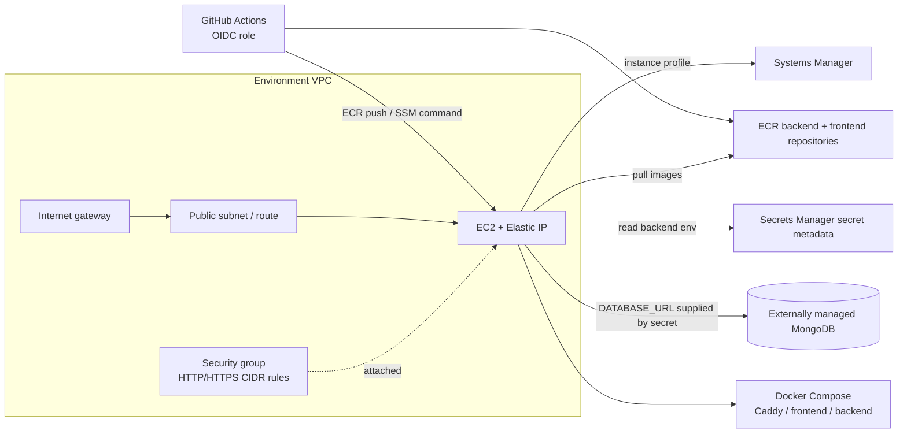

# Infrastructure architecture

## Overview

The `dev/` and `prod/` directories are separate Terraform roots. They call
shared modules in `modules/` but use distinct environment names, resource
names and S3 state keys. They are separate configurations, not a guarantee of
separate AWS accounts; the AWS credentials selected by the operator determine
the target account.

The roots require Terraform 1.10 or later and explicitly constrain
`hashicorp/aws` to `~> 5.0`. The GitHub OIDC module uses `hashicorp/tls` to
read the OIDC endpoint certificate; provider selections are recorded in the
root lock files.

MongoDB in this diagram is an external dependency, not a resource in the
Terraform roots or the deployment Compose file. The Terraform package does
not create DNS records, application monitoring, database backups, or a
managed database.

## Root-to-module relationships

| Terraform module | Resources / role in the environment |
|---|---|
| `network` | VPC with DNS support, internet gateway, one public subnet, public route table and association |
| `security_group` | Allows inbound HTTP 80 and HTTPS 443 only from configured IPv4 CIDRs; allows all outbound IPv4 |
| `ec2` | One EC2 instance, encrypted gp3 root disk, IMDSv2 required, Elastic IP and association |
| `iam` | EC2 role and instance profile, Systems Manager managed-instance policy, ECR pull access and environment secret read access |
| `ecr` | Backend/frontend repositories, AES-256 ECR encryption, scan on push, immutable tags, lifecycle retention of the 10 most recent images |
| `secrets_manager` | Creates the backend secret metadata/name with a 7-day recovery window; does not create a secret value/version |
| `github_oidc` | GitHub OIDC provider (owned by one root/account), environment-subject trust role, ECR push and SSM deployment policies |

EC2 user data installs Ubuntu packages `docker.io`, `docker-compose-v2`,
`curl`, and `unzip`, installs AWS CLI v2, enables Docker, and adds the
`ubuntu` user to the Docker group. User data is not a full host-hardening
baseline or application provisioning system.

## Environment isolation

- The roots have separate S3 backend keys (`kaindra/dev/terraform.tfstate`
  and `kaindra/prod/terraform.tfstate`).
- Root module arguments use `dev` and `prod`; resources are named/tagged with
  those environment identifiers and the project name.
- The GitHub OIDC trust names the repository
  `anusree-ux/project-kaindra` and GitHub Environment `development` or
  `production`.
- Production uses required values for region, instance type, volume size,
  VPC/subnet CIDRs and web ingress CIDRs.
- Dev and prod can still point at the same AWS account if operators use the
  same account credentials. State separation is not account separation.

The deployment workflow expects actual EC2 `Environment` tags to be
`development` or `production`, while the roots currently pass `dev` or `prod`
to the EC2 module. This mismatch must be resolved through an approved
infrastructure change before the workflow identity check can pass.

## Network and traffic

Each root creates one public subnet and assigns a public address; an
Elastic IP is associated with the EC2 instance. Security-group ingress is
restricted to the root variable lists for ports 80 and 443. Terraform does
not create SSH ingress. Egress is unrestricted IPv4 in the module.

The AWS deployment Compose stack publishes Caddy ports 80 and 443. Caddy
routes `/api/*` and `/socket.io/*` to the backend and other requests to the
frontend. The configured hostname must resolve to the EC2 Elastic IP, and
the ingress lists must allow the traffic required for public HTTP/HTTPS and
Caddy certificate issuance/renewal.

## Data and persistence

- The AWS deployment Compose file defines backend, frontend and Caddy; it has
  named volumes for Caddy data/configuration but no MongoDB service.
- The backend reads its MongoDB connection string from the externally
  supplied application environment secret.
- Local development Compose adds MongoDB 8.0 with a named `mongodb_data`
  volume. This is local development data, not a production backup strategy.
- No backup schedule, database restore automation, or tested disaster
  recovery procedure is implemented in Terraform or the deployment workflow.

## Image and deployment relationships

GitHub Actions builds backend/frontend images and pushes them to ECR using
the tested commit SHA as the immutable tag. It resolves each tag to an ECR
digest and sends digest-pinned references to the EC2 deployment. The EC2
instance pulls the digests and Compose starts the services. See
[Deployment](./DEPLOYMENT.md) for the full execution and rollback flow.
